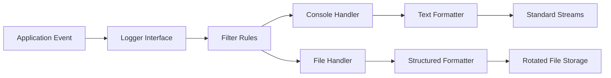

# Logging Architecture and Implementation

This document specifies the logging architecture, severity standards, formatting specifications, and operational patterns for application logging.

---

## 1. System Overview and Rationale

Logging provides an immutable, time-sequenced record of runtime execution, system diagnostics, and operational events. Standard output (`print`) is insufficient for production software due to structural limitations:

| Evaluation Dimension | Standard Output (`print`) | Structured Logging Subsystem |
| :--- | :--- | :--- |
| **Persistence** | Volatile; lost on process exit unless redirected | Written to local disk, log forwarders, or syslog |
| **Severity Granularity** | Uniform priority | Hierarchical levels (`DEBUG`, `INFO`, `WARNING`, `ERROR`, `CRITICAL`) |
| **Metadata Injection** | Manual string formatting required | Automatic emission of timestamps, process IDs, file names, and line numbers |
| **I/O Routing** | Bound to standard output/error descriptors | Independent routing to multiple synchronous or asynchronous sinks |
| **Runtime Control** | Immutable without source code modifications | Dynamically configurable via environment variables or configuration files |
| **Thread Safety** | Prone to interleaved output under contention | Serialized via internal synchronization primitives |

### Functional Objectives
- **Fault Diagnosis:** Isolation of runtime defects, edge-case exceptions, and logic failures in non-interactive environments.
- **Audit Logging:** Generation of compliance-grade records for business-critical operations (e.g., authentication, transaction processing, document extraction).
- **Latency Profiling:** Recording of discrete step durations across I/O-bound operations.
- **Security Monitoring:** Detection of anomalous input patterns, brute-force attempts, and unauthorized endpoint access.

---

## 2. Core Architecture

The logging pipeline implements a four-stage decoupling pattern:



### Architectural Components

1. **Logger:** The primary programming interface accessed by modules (`logging.getLogger(__name__)`). Loggers are organized hierarchically via dot notation (`app.module.submodule`). Child loggers propagate records up to parent loggers unless explicit propagation boundaries are declared.
2. **Handler:** Directs records to specific destinations. Multiple handlers can attach to a single logger with independent severity filters.
3. **Formatter:** Transforms raw record payloads and metadata into standard textual or machine-readable representations (e.g., structured JSON, delimited text).
4. **Filter:** Provides contextual gating of log records beyond scalar severity thresholds (e.g., matching regular expressions, suppressing specific error codes, or injecting correlation identifiers).

---

## 3. Severity Classification

Events are classified into standardized numeric tiers. Records submitted below the logger's configured threshold are dropped prior to handler dispatch:

| Severity Level | Numeric Value | Operational Definition | Intended Use Case |
| :--- | :--- | :--- | :--- |
| **`DEBUG`** | 10 | Diagnostic information for troubleshooting. | State dumps, payload serialization, step-by-step loop execution, timing metrics. |
| **`INFO`** | 20 | Normal operational milestones indicating correct behavior. | Service initialization, batch job completion, successful user authorization. |
| **`WARNING`** | 30 | Unexpected conditions or recoverable anomalies. | Deprecated dependency invocation, transient network retry, high resource utilization. |
| **`ERROR`** | 40 | Operation failure affecting a specific request or task. | Database transaction rollback, external API connection rejection, unhandled exception. |
| **`CRITICAL`** | 50 | Catastrophic failure resulting in service termination or data loss. | Database storage exhaustion, process abort, unrecoverable configuration corruption. |

---

## 4. Handler Specifications and Destinations

### Standard Handlers
- **`StreamHandler`:** Routes output to stream descriptors, typically `sys.stdout` or `sys.stderr`.
- **`FileHandler`:** Appends output directly to a designated disk file.

### Production Rotation Handlers
To prevent unbounded disk consumption, file-based logging must incorporate retention policies:
- **`RotatingFileHandler`:** Rotates files upon reaching a byte threshold (`maxBytes`). Once exhausted, existing archives are renamed incrementally (`.1`, `.2`), and the oldest archive beyond `backupCount` is deleted.
- **`TimedRotatingFileHandler`:** Rotates files at predetermined wall-clock intervals (e.g., daily, hourly) regardless of file size.

### Advanced Handlers
- **`QueueHandler` & `QueueListener`:** Decouples logging I/O from execution threads. Log records are placed onto an in-memory queue, and a dedicated worker thread processes writes asynchronously.
- **`SysLogHandler`:** Transmits records directly to local or network-accessible `syslog` daemons.
- **`MemoryHandler`:** Buffers records in memory until a trigger condition (such as an `ERROR` event) flushes the backlog to a downstream handler.

---

## 5. Record Formatting Standards

### Unstructured Delimited Format
Designed for human readability during development:

```text
2026-11-07 20:30:15,123 | INFO | insurance_assistant.pipeline | Document loaded successfully
```

#### Standard Format Attributes
- `%(asctime)s`: Formatted timestamp of record generation.
- `%(levelname)s`: Textual severity level (`INFO`, `ERROR`, etc.).
- `%(name)s`: Name of the emitting logger.
- `%(filename)s`: Source file basename where the call was initiated.
- `%(lineno)d`: Line number within the source file.
- `%(funcName)s`: Calling function or method name.
- `%(process)d`: Operating system Process ID (PID).
- `%(threadName)s`: Calling thread identifier.
- `%(message)s`: The primary message body.

### Structured (JSON) Format
Optimized for centralized aggregation platforms (e.g., Datadog, Elasticsearch, CloudWatch):

```json
{
  "timestamp": "2026-11-07T15:00:15.123Z",
  "level": "INFO",
  "logger": "insurance_assistant.pipeline",
  "message": "Document loaded successfully",
  "file_path": "data/policy.txt",
  "document_count": 1,
  "execution_time_ms": 42.5
}
```

---

## 6. Implementation Reference

### Modular Application Pattern
The standard pattern used in application packages:

```python
import logging
import os
from datetime import datetime

log_dir = "logs"
os.makedirs(log_dir, exist_ok=True)

now = datetime.now()
today_folder = now.strftime("%Y-%m-%d")
daily_log_dir = os.path.join(log_dir, today_folder)
os.makedirs(daily_log_dir, exist_ok=True)

_run_started_at = now.strftime("%Y%m%d_%H%M%S")
run_log_file = os.path.join(daily_log_dir, f"run_{_run_started_at}.log")

logging.basicConfig(
    level=logging.INFO,
    format="%(asctime)s | %(levelname)s | %(name)s | %(message)s",
    handlers=[
        logging.FileHandler(run_log_file, encoding="utf-8", delay=True),
        logging.StreamHandler(),
    ],
)

def get_logger(name: str) -> logging.Logger:
    """Return a logger configured with the parent hierarchy."""
    return logging.getLogger(name)
```

---

## 7. Advanced Patterns and Techniques

### Exception Traceback Preservation
Exceptions must be logged using `logger.exception()` or `exc_info=True` to preserve full stack trace context:

```python
try:
    result = perform_operation()
except SpecificError as e:
    logger.exception("Failed to execute operation: %s", e)
```

### Contextual Metadata via `LoggerAdapter`
To correlate distributed actions across a request lifecycle:

```python
import logging

class CorrelationIdAdapter(logging.LoggerAdapter):
    def process(self, msg, kwargs):
        return f"[{self.extra['correlation_id']}] {msg}", kwargs

base_logger = logging.getLogger("service")
logger = CorrelationIdAdapter(base_logger, {"correlation_id": "tx-849204"})
logger.info("Executing transaction")
```

---

## 8. Operational Rules and Anti-Patterns

### Required Standards
1. **Hierarchical Logger Naming:** Always instantiate loggers via `logging.getLogger(__name__)`.
2. **Lazy Parameter Evaluation:** Pass variables as arguments (`logger.info("Count: %d", count)`) rather than pre-interpolating f-strings to prevent unnecessary formatting overhead when debug logging is disabled.
3. **Deferred File Opening:** Use `delay=True` on `FileHandler` to avoid generating empty 0-byte log files during module import passes.
4. **Library Decoupling:** Internal library packages must not configure root handlers or call `logging.basicConfig()`; configuration is strictly reserved for the application entry point.

### Anti-Patterns
1. **Credential Exposure:** Passwords, API tokens, bearer authorization headers, and personally identifiable information (PII) must be masked prior to logging.
2. **Silent Failure Suppression:** Never catch generic exceptions without emitting an error-level log and traceback.
3. **Synchronous Network Logging:** Remote log forwarders must operate asynchronously or over buffering queues to prevent external network latency from blocking the application runtime.
