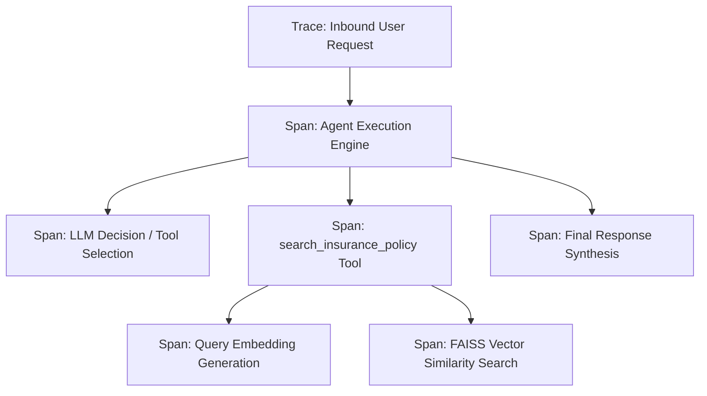

# Tracing and Observability Specification

This document defines the tracing architecture, telemetry lifecycle, span hierarchy, and integration patterns for Large Language Model (LLM) and Retrieval-Augmented Generation (RAG) subsystems.

---

## 1. Overview and Operational Rationale

Traditional application monitoring observes deterministic control flows where an input maps directly to code branches. In contrast, RAG and autonomous agent workflows execute dynamic, multi-stage directed acyclic graphs (DAGs):

1. Query embedding generation.
2. Vector distance calculations across index partitions.
3. Document chunk retrieval, re-ranking, and context filtering.
4. Dynamic prompt assembly with injected external knowledge.
5. Autonomous agent decision-making and tool selection cycles.
6. Multi-stage reasoning and answer generation.

When system responses deviate from expected behavior or exhibit elevated latency, standard logging fails to capture the inter-component causal relationships. Tracing provides continuous visibility into each node of the execution graph.

---

## 2. Comparison: Logging vs. Tracing

Logging and tracing serve distinct roles within the observability lifecycle:

| Dimension | Logging Subsystem | Distributed Tracing Subsystem |
| :--- | :--- | :--- |
| **Data Structure** | Unstructured or structured discrete records | Hierarchical, parent-child directed acyclic graph (DAG) |
| **Observation Scope** | Point-in-time, localized component event | Continuous request journey across all system boundaries |
| **Contextual Binding** | Localized to emitting module | Propagated across callers, sub-chains, and external APIs |
| **Telemetry Payload** | Message strings, error exceptions | Complete inputs, outputs, system prompts, and tool parameters |
| **Performance Profiling** | Discrete start/stop timing logs | Waterfall visualization isolating sub-millisecond latencies per span |
| **Resource Accounting** | Manual emission | Automatic tracking of input, output, and reasoning token totals |

---

## 3. Core Architectural Concepts



### 1. Trace
A trace represents the entire execution lifecycle of a single user invocation, encompassing all downstream operations from receipt to response return.

### 2. Span (Run)
A span constitutes a discrete execution segment within a trace. Standard attributes captured per span include:
- **Identifier:** Unique run ID and parent run ID for hierarchy linking.
- **Run Type:** Classification of the component (`llm`, `tool`, `retriever`, `chain`, `prompt`).
- **Inputs:** Exact invocation payload (system prompts, user messages, parameters).
- **Outputs:** Exact return payload (retrieved documents, tool outputs, generated text).
- **Duration:** Millisecond-resolution start and end timestamps.
- **Token Metrics:** Breakdown of prompt tokens, completion tokens, and total usage.
- **Error Diagnostics:** Exception class, message, and traceback upon failure.

### 3. Span Hierarchy
Spans maintain parent-child relationships. When an agent calls a retrieval tool, the tool execution is recorded as a child span of the agent. Downstream vector searches are recorded as child spans of the retrieval tool.

---

## 4. Diagnostics in RAG Systems

### Failure Isolation
Tracing distinguishes between the two primary failure modes of retrieval-augmented systems:
- **Retrieval Failures:** The vector store retrieved irrelevant or insufficient context chunks. Tracing reveals the exact text segments supplied to the model, confirming whether required clauses were omitted.
- **Reasoning Failures:** The retriever identified the correct context chunks, but the language model misinterpreted or ignored the text. Tracing isolates the prompt inputs from model outputs to prove grounding compliance.

### Latency Deconstruction
In multi-component pipelines, tracing provides an exact breakdown of execution time across components:
- External embedding API call latency.
- Local vector database index search time.
- Time-to-first-token and total completion latency of the language model.

### Context Window and Cost Monitoring
Traces log exact token consumption across input context, injected chunks, and output generation, enabling capacity planning and API quota monitoring.

---

## 5. LangSmith Integration

[LangSmith](https://smith.langchain.com/) provides managed trace aggregation, visualization, and evaluation for LangChain-based pipelines.

### Execution Mechanism
1. LangChain integrates background telemetry hooks within its runnable interfaces.
2. When tracing is enabled, operations serialize inputs, outputs, and metadata into telemetry payloads.
3. Payloads are dispatched over background worker threads to the LangSmith ingestion API asynchronously, ensuring zero impact on user response latency.

### Configuration Specification
Tracing is managed via standard environment variables:

| Environment Variable | Format | Definition |
| :--- | :--- | :--- |
| `LANGSMITH_TRACING` | `"true"` / `"false"` | Global activation toggle for telemetry collection. |
| `LANGSMITH_API_KEY` | String | Authentication key generated from the LangSmith dashboard. |
| `LANGSMITH_PROJECT` | String | Logical namespace under which traces are grouped (e.g., `"PolicyScan"`). |
| `LANGSMITH_ENDPOINT` | URL | Telemetry ingestion endpoint (defaults to official cloud endpoint). |

---

## 6. Implementation Reference

### Validation Interface
A dedicated validation module verifies tracing configuration prior to application execution:

```python
from insurance_assistant import config
from insurance_assistant.logger import get_logger

logger = get_logger(__name__)

def check_langsmith_tracing() -> bool:
    """Validate and log LangSmith configuration state."""
    is_enabled = str(config.LANGSMITH_TRACING).lower() == "true"

    if not is_enabled:
        logger.info("LangSmith tracing is disabled")
        return False

    if not config.LANGSMITH_API_KEY:
        logger.warning("LangSmith tracing is enabled, but LANGSMITH_API_KEY is missing")
        return False

    project_name = config.LANGSMITH_PROJECT or "default"
    logger.info("LangSmith tracing is enabled for project: %s", project_name)
    return True
```

### Pipeline Integration
The validation routine is executed during assistant initialization in `pipeline.py`:

```python
def build_insurance_assisstant(file_path: str = config.data_path):
    logger.info("Initializing insurance assistant pipeline")
    config.check_api_keys()
    check_langsmith_tracing()
    
    # Assembly of vector store, retriever, tools, and agent...
```

---

## 7. Operational Standards

1. **Non-Blocking Telemetry:** Telemetry collection must remain non-blocking to prevent third-party network failures from degrading application availability.
2. **Environment Segregation:** Development, testing, and production environments must use distinct `LANGSMITH_PROJECT` values (e.g., `PolicyScan-dev`, `PolicyScan-prod`) to prevent evaluation data corruption.
3. **Data Sanitization:** Where user queries may contain sensitive personal information, redaction rules must be applied prior to external trace transmission.
4. **Offline Parity:** Tracing complements rather than replaces local logging; runtime health and audit trails must continue to be logged locally via day-wise file sinks.
