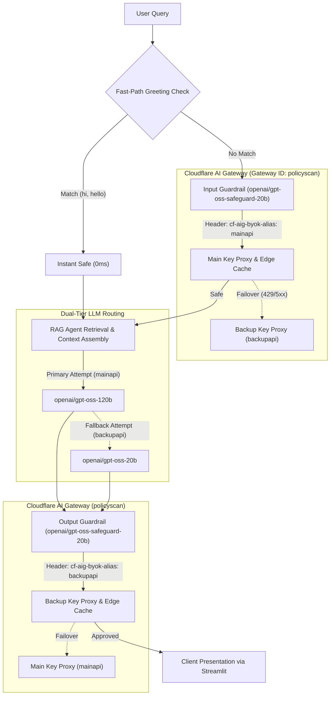
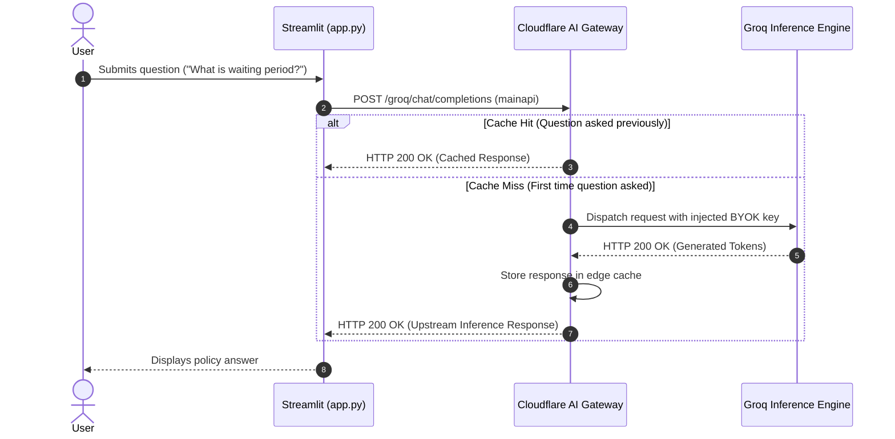

# Cloudflare AI Gateway Architecture and Multi-Tier LLM Routing

This document specifies the technical architecture, security protocols, routing dynamics, and edge caching mechanisms for the LLM gateway subsystem in PolicyScan, powered by Cloudflare AI Gateway and Groq LPUs.

---

## 1. System Overview and Operational Rationale

Large Language Model applications deployed in production face several operational challenges:
1. **Provider Rate Limiting (TPM/RPM):** Provider quotas on specialized models (such as safety evaluators) can cause sudden HTTP 429/413 errors during traffic spikes.
2. **Network Resilience & Latency Variance:** Upstream provider latency jitter, network drops, or gateway timeouts directly impact the user experience.
3. **Secret Sprawl:** Distributing raw provider API keys across multiple runtime instances increases credential exposure risk.
4. **Redundant Inference Costs:** Frequently repeated questions (such as common policy inquiries or greetings) re-run identical generative inference cycles, consuming provider tokens needlessly.

To resolve these constraints, PolicyScan introduces an intermediary gateway layer between the LangChain execution engine and the upstream Groq inference infrastructure using **Cloudflare AI Gateway**.

### Architecture Overview



---

## 2. Gateway Endpoints and BYOK Authentication Protocol

### Endpoint Structure

Cloudflare AI Gateway provides unified proxy endpoints for upstream LLM providers. For Groq-hosted models, requests target the OpenAI-compatible chat completion route:

```text
https://gateway.ai.cloudflare.com/v1/{CLOUDFLARE_ACCOUNT_ID}/{CLOUDFLARE_GATEWAY_ID}/groq
```

In PolicyScan:
- **`CLOUDFLARE_ACCOUNT_ID`:** Unique Cloudflare account identifier.
- **`CLOUDFLARE_GATEWAY_ID`:** The gateway instance name (`policyscan`).
- **Provider Target:** `/groq` indicates that requests are forwarded to Groq LPUs.

### BYOK (Bring Your Own Key) Security Model

Rather than embedding raw Groq API keys in local environment variables across application containers, PolicyScan uses Cloudflare's **BYOK Secret Vault**:
- Multiple Groq API keys are stored securely inside the Cloudflare AI Gateway dashboard as encrypted secrets.
- Each key is assigned an identifier called an **Alias** (`mainapi` and `backupapi`).
- At request time, the application passes the alias in an HTTP header. Cloudflare injects the corresponding decrypted provider key at the edge before dispatching the request to Groq.

### Header Specification

The gateway module ([gateway.py](file:///d:/Github%20Projects/PolicyScan/insurance_assistant/gateway.py)) attaches the following HTTP headers to every outbound call:

| Header Name | Type | Description |
| :--- | :--- | :--- |
| `cf-aig-authorization` | String | `Bearer {CLOUDFLARE_API_TOKEN}` authenticating the application with Cloudflare. |
| `cf-aig-byok-alias` | String | Key alias (`mainapi` or `backupapi`) instructing Cloudflare which stored Groq key to inject. |
| `cf-aig-collect-log-payload` | Boolean | `false` ensures raw user query text is not retained in unencrypted gateway logs. |
| `cf-aig-metadata` | JSON String | Telemetry metadata tagging the application name (`PolicyScan`), alias, and attempt number. |
| `Authorization` | String | Set to an empty string (`""`) to prevent client libraries from transmitting extraneous credentials. |

---

## 3. Multi-Tier Model & Traffic Distribution Architecture

PolicyScan operates three distinct LLM workflows per user inquiry:
1. **Input Guardrail:** Evaluates user prompt safety.
2. **RAG Agent Synthesis:** Executes vector retrieval and answers the policy question.
3. **Output Guardrail:** Validates assistant answer safety before delivery.

To prevent quota exhaustion on provider free tiers (specifically the 2,000 TPM limit on safeguard models), traffic is distributed across two separate key aliases:

```
+-----------------------------------------------------------------------------+
|                               Traffic Matrix                                |
+-----------------------+-------------------+--------------------+------------+
| Component             | Primary Alias     | Model Engine       | Failover   |
+-----------------------+-------------------+--------------------+------------+
| Input Safety Rail     | mainapi           | gpt-oss-safeguard  | backupapi  |
| Primary RAG Assistant | mainapi           | openai/gpt-oss-120b| backupapi  |
| Fallback RAG Model    | backupapi         | openai/gpt-oss-20b | None       |
| Output Safety Rail    | backupapi         | gpt-oss-safeguard  | mainapi    |
+-----------------------+-------------------+--------------------+------------+
```

### Technical Benefits of This Partitioning:

1. **Dual-Key Token Balancing:** The input rail consumes tokens against `mainapi`, while the output rail consumes tokens against `backupapi`. This distributes the guardrail request volume across two distinct provider keys.
2. **Asymmetric Failover:** If `mainapi` hits a temporary provider rate limit (HTTP 429/413) during input verification, the request immediately cascades to `backupapi`. Similarly, if `backupapi` is constrained during output verification, it cascades to `mainapi`.
3. **Model Tiering for Cost and Availability:** The primary agent uses the flagship 120B parameter model (`openai/gpt-oss-120b`). If the 120B model is temporarily rate-limited or experiencing high upstream latency, the fallback automatically switches to the lightweight 20B model (`openai/gpt-oss-20b`).

---

## 4. Edge Caching Mechanics

Cloudflare AI Gateway evaluates incoming request payloads (endpoint, model, messages, temperature) against an edge-distributed cache.



### Cache Retention Across User Sessions

- **Scope:** The gateway cache is server-side and global. It persists independently of client state.
- **Session Reset ("New Chat"):** When a user clicks "New Chat" in the Streamlit UI, only the browser-level message state (`st.session_state.messages`) is cleared. The Cloudflare edge cache remains fully active.
- **Zero Token Consumption:** Any subsequent query that matches a cached entry returns directly from Cloudflare's edge cache without consuming upstream provider tokens.

---

## 5. Implementation Specification

### 1. Gateway Client Factory (`insurance_assistant/gateway.py`)

The module exports `create_gateway_llm`, which instantiates an OpenAI-compatible client routed through the gateway:

```python
def create_gateway_llm(
    alias: str,
    model_name: str = config.llm_model_name,
    attempt: int = 1,
) -> ChatOpenAI:
    base_url = get_gateway_url()
    headers = get_gateway_headers(alias, attempt)
    return ChatOpenAI(
        model=model_name,
        api_key="placeholder",
        base_url=base_url,
        default_headers=headers,
        temperature=0,
    )
```

### 2. RAG LLM Fallback Chain (`insurance_assistant/llm.py`)

The primary language model is configured with a native LangChain fallback chain:

```python
main_llm = create_gateway_llm(
    alias=config.CLOUDFLARE_GATEWAY_MAIN,
    model_name=config.llm_model_name,
    attempt=1,
)
backup_llm = create_gateway_llm(
    alias=config.CLOUDFLARE_GATEWAY_BACKUP,
    model_name=config.llm_backup_model_name,
    attempt=2,
)

return main_llm.with_fallbacks([backup_llm])
```

### 3. Split Guardrail Verification (`insurance_assistant/guardrails.py`)

Input checks route through `mainapi` (falling back to `backupapi`), while output checks route through `backupapi` (falling back to `mainapi`):

```python
# Input Guardrail: mainapi primary, backupapi failover
def _get_input_guard_llm():
    primary = create_gateway_llm(alias=config.CLOUDFLARE_GATEWAY_MAIN, ...)
    fallback = create_gateway_llm(alias=config.CLOUDFLARE_GATEWAY_BACKUP, ...)
    return primary.with_fallbacks([fallback])

# Output Guardrail: backupapi primary, mainapi failover
def _get_output_guard_llm():
    primary = create_gateway_llm(alias=config.CLOUDFLARE_GATEWAY_BACKUP, ...)
    fallback = create_gateway_llm(alias=config.CLOUDFLARE_GATEWAY_MAIN, ...)
    return primary.with_fallbacks([fallback])
```

---

## 6. Configuration Reference

The following parameters in `.env` govern gateway operations:

| Variable Name | Required | Default | Description |
| :--- | :--- | :--- | :--- |
| `CLOUDFLARE_ACCOUNT_ID` | Yes (for gateway) | None | Cloudflare account identifier. |
| `CLOUDFLARE_API_TOKEN` | Yes (for gateway) | None | Cloudflare API token with AI Gateway read/write permissions. |
| `CLOUDFLARE_GATEWAY_ID` | Yes (for gateway) | `policyscan` | Gateway slug configured in Cloudflare Dashboard. |
| `CLOUDFLARE_GATEWAY_MAIN` | No | `mainapi` | BYOK key alias for primary inference and input guardrails. |
| `CLOUDFLARE_GATEWAY_BACKUP` | No | `backupapi` | BYOK key alias for backup inference and output guardrails. |
| `CLOUDFLARE_BACKUP_MODEL` | No | `openai/gpt-oss-20b` | Model identifier utilized when primary model fails over. |

---

## 7. Operational Troubleshooting

### Error Code 2001: "Please configure AI Gateway in the Cloudflare dashboard"
- **Cause:** The `CLOUDFLARE_GATEWAY_ID` does not match an existing gateway slug in the Cloudflare account, or a key alias was passed in the URL path instead of the `cf-aig-byok-alias` header.
- **Remedy:** Ensure `CLOUDFLARE_GATEWAY_ID="policyscan"` and verify that the gateway is active in the Cloudflare dashboard.

### HTTP 413 Payload Too Large / HTTP 429 Too Many Requests
- **Cause:** Upstream Groq TPM limit exceeded on preview models.
- **Remedy:** Mitigated automatically by the gateway's cross-key failover (`mainapi` &rarr; `backupapi`) and edge caching. Ensure edge caching is enabled in the Cloudflare AI Gateway dashboard settings.

