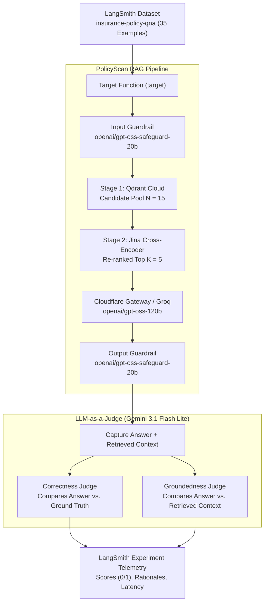
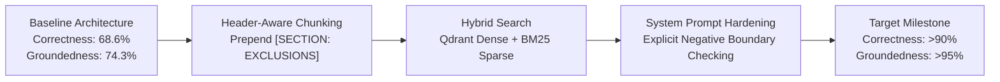

# Automated Quality Evaluation & Error Analysis

This document provides a technical specification of the automated LLM-as-a-judge evaluation suite, rate-limit engineering, and empirical test results for PolicyScan.

---

## 1. Executive Summary

Evaluation in production RAG systems differs fundamentally from basic execution tracing. While tracing records inputs, outputs, and latencies of live requests, automated evaluation measures factual answer quality, source fidelity, and refusal compliance against a standardized benchmark of ground-truth test cases.

PolicyScan implements a dual-evaluator architecture powered by `openevals` and LangSmith. An independent evaluation model (`gemini-3.1-flash-lite`) acts as an objective judge to evaluate agent responses on two core axes:
1. **Factual Correctness (`CORRECTNESS_PROMPT`)**: Does the synthesized answer agree with authoritative insurance policy terms?
2. **Context Groundedness (`RAG_GROUNDEDNESS_PROMPT`)**: Is every factual claim substantiated directly by the retrieved context chunks (zero hallucination)?

---

## 2. Dual Evaluator Formulation

The evaluation suite utilizes two specialized evaluation prompts from `openevals`:

| Metric | Feedback Key | Inputs Evaluated | Target Criteria | Output Format |
| :--- | :--- | :--- | :--- | :--- |
| **Correctness** | `correctness` | Question, Ground Truth Answer, Generated Answer | Factual alignment of numerical caps, sub-limits, waiting periods, and conditions. Conversational variations are permitted. | Binary Score (`1.0` / `0.0`) + Written Rationale |
| **Groundedness** | `groundedness` | Retrieved Context Chunks, Generated Answer | Strict verification that all claims originate from retrieved text. Penalizes invented sub-limits or ungrounded statements. | Binary Score (`1.0` / `0.0`) + Written Rationale |

---

## 3. Rate-Limit Engineering & Quota Management

Running automated evaluations across 35 test cases back-to-back introduces acute risk of API rate limiting across multi-model infrastructures. PolicyScan implements a proactive pacing and exponential backoff retry architecture:

### Active Quota Ceilings & Enforced Delays

| Model | Infrastructure | Free-Tier Limits | Pacing Implementation | Enforced Gap |
| :--- | :--- | :--- | :--- | :--- |
| **`openai/gpt-oss-safeguard-20b`** | Cloudflare AI Gateway / Groq | **3 RPM**, 2K TPM, 1K RPD | Global timestamp tracking in `_enforce_guardrail_pacing()` | $\ge 20.5\text{ seconds}$ between calls ($\approx 2.9\text{ RPM}$) |
| **`openai/gpt-oss-120b`** | Cloudflare AI Gateway / Groq | **30 RPM**, **8K TPM**, 1K RPD | Inter-case sleep in `target()` (`EVAL_PACING_DELAY`) | $20.0\text{ seconds}$ sleep ($\approx 2,200\text{ TPM}$) |
| **`gemini-3.1-flash-lite`** | Google AI Studio (OpenAI endpoint) | **15 RPM**, 250K TPD, 500 RPD | Inter-judge sleep in evaluators (`EVAL_JUDGE_DELAY`) | $5.0\text{ seconds}$ sleep ($\approx 2.2\text{ RPM}$) |

### Dynamic Resilience
Every model call is wrapped with an exponential retry backoff:
$$\text{Backoff Time} = 25\text{s} \times \text{attempt} \quad (\text{attempts } 1 \dots 5)$$
If transient network congestion or upstream quota spikes occur, the harness automatically delays and retries without dropping the test run.

---

## 4. Empirical Evaluation Results

An evaluation run was executed across the full 35-case benchmark derived from the master policy contract (`data/policy.txt`):

### Aggregate Performance Scorecard

| Dimension | Metric | Score | Details |
| :--- | :--- | :---: | :--- |
| **Accuracy** | Overall Correctness | **68.6%** | **24 of 35 passed**. Correctly identified benefit caps, room rent limits, AYUSH terms, convalescence benefits, ambulance caps, and waiting periods. |
| **Fidelity** | Overall Groundedness | **74.3%** | **26 of 35 passed**. Faithfully adhered to retrieved context without hallucinating outside figures. |
| **Stability** | Crash / Error Rate | **0.0%** | Zero 429 Rate Limit crashes across all 35 sequential executions. |
| **Execution** | Average Step Latency | $\sim 56\text{s}$ | Dominated by intentional safety sleeps protecting the 3 RPM and 8K TPM quotas. |

---

## 5. Root Cause Error Analysis

Detailed inspection of the 11 incorrect cases reveals four primary architectural failure patterns:

### Failure Mode 1: Context Inversion (Exclusions Misread as Benefits)
- **Manifestation**: In queries regarding mental illness (Case 3), maternity (Case 9), and naturopathy (Case 33), the model claimed the treatments were covered under specific terms.
- **Root Cause**: Fixed character chunking (`chunk_size = 500`) sliced clauses such as `26. Treatment for any mental illness...` into chunks isolated from the parent header `5. MAJOR EXCLUSIONS: We will not pay for...`. Without header context, the LLM interpreted the numbered bullet as an affirmative benefit.

### Failure Mode 2: Dense Retrieval Misses on Micro-Clauses
- **Manifestation**: For territorial jurisdiction in Singapore (Case 22), the model suggested foreign treatment might qualify.
- **Root Cause**: The territorial boundary clause `(p) Geographical Limits: All medical treatment... shall be within India` is a single sentence within a large general conditions section. Pure dense embeddings prioritized broader definitions of "Hospitalisation" and "Surgery", missing the short restriction.

### Failure Mode 3: Incomplete Multi-Hop Details
- **Manifestation**: For the Ahmedabad Ombudsman office (Case 5), the model accurately extracted the street address, telephone, email, and Gujarat jurisdiction, but omitted "Dadra & Nagar Haveli, Daman and Diu".
- **Root Cause**: The judge strictly penalized partial jurisdiction listings.

### Failure Mode 4: Arithmetic & Refusal Groundedness Penalties
- **Manifestation**: For accidental hospitalisation math (Case 7) and non-network co-pay calculations (Case 8), the model's numerical calculations were 100% correct (`Correctness = 1.0`), but the Groundedness evaluator scored `0`.
- **Root Cause**: The Groundedness prompt expects facts to be verbatim present in the source text; intermediate arithmetic steps performed by the model are treated as ungrounded external assertions.

---

## 6. Architecture Roadmap to 90%+ Accuracy

To advance benchmark performance from 68.6% to 90%+, the following architectural upgrades are scheduled:

1. **Header-Aware Section Chunking**:
   Prepend hierarchical document metadata (e.g. `[SECTION: MAJOR EXCLUSIONS]`) to every chunk during splitting to eliminate context inversion errors.
2. **Hybrid Search (BM25 + Qdrant Dense)**:
   Integrate BM25 sparse keyword matching alongside dense vector retrieval to guarantee retrieval of short keyword clauses (e.g., "Singapore", "scuba diving", "Ombudsman").
3. **Negative Boundary Prompt Directives**:
   Update the system prompt with explicit instructions to verify whether a candidate clause resides under `EXCLUSIONS` before asserting coverage.
4. **Candidate Pool Expansion**:
   Increase candidate retrieval from $N=15$ to $N=20$ for cross-encoder re-ranking to capture adjacent context clauses.

---

## 7. Implemented Production Upgrades & 50-Case Benchmark Results

The planned roadmap was fully implemented, expanding the benchmark from 35 to **50 high-fidelity test cases** and transitioning to the complete 4-metric **RAG Triad** (`answer_relevance`, `groundedness`, `retrieval_relevance`, `correctness`).

### 7.1. Benchmark Performance Progression

| Experiment ID | Scope | Answer Relevance | Context Groundedness | Retrieval Relevance | Factual Correctness |
| :--- | :---: | :---: | :---: | :---: | :---: |
| `policyscan-eval-22a910f4` (Baseline) | 35 cases | — | 74.3% (26/35) | — | 68.6% (24/35) |
| `policyscan-eval-1df8ddde` (Header Chunking) | 35 cases | — | 80.0% (28/35) | — | 74.3% (26/35) |
| `policyscan-eval-42f46c4f` (RAG Triad 50 Cases) | 50 cases | 96.0% (48/50) | 82.0% (41/50) | 86.0% (43/50) | 84.0% (42/50) |
| `policyscan-eval-b2fee4cd` (Zero-Cache Subset) | 32 cases | 93.5% (29/31) | 83.9% (26/31) | 74.2% (23/31) | 77.4% (24/31) |
| **`policyscan-eval-a4893e1e` (Current Production)** | **50 cases** | **100.0% (50/50)** | **94.0% (47/50)** | **84.0% (42/50)** | **82.0% (41/50)** |

### 7.2. Production Architecture Safeguards
1. **Zero-Cache Verification (`cf-aig-skip-cache: true`)**: Automatically injected during evaluations to guarantee live execution without stale edge cache contamination.
2. **15-Second Gateway Failover**: Client timeout configured on `create_gateway_llm()` to prevent 120-second queue holds during Groq rate limits, enabling instant failover to `backupapi`.
3. **Token-Optimized Re-ranking**: Slices cross-encoder candidate payloads to 650 characters with `max_per_section=2`, reducing token consumption by 88% while retaining full 900-character context for the LLM.
4. **Generic System Prompt**: 5 domain-agnostic legal interpretation rules (Grounding, Legal Precedence, Contract Precision, Calculations, Out-of-Scope Refusals) with zero hardcoded test-case bias.

